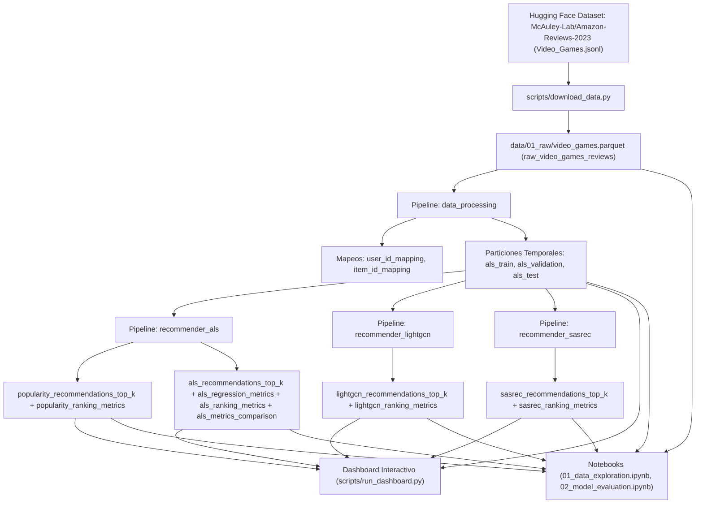
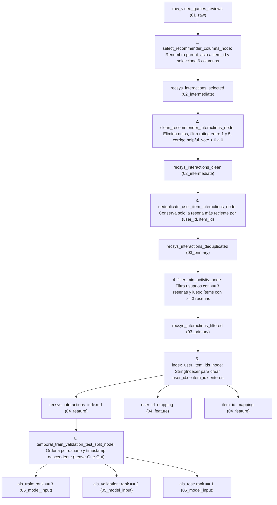
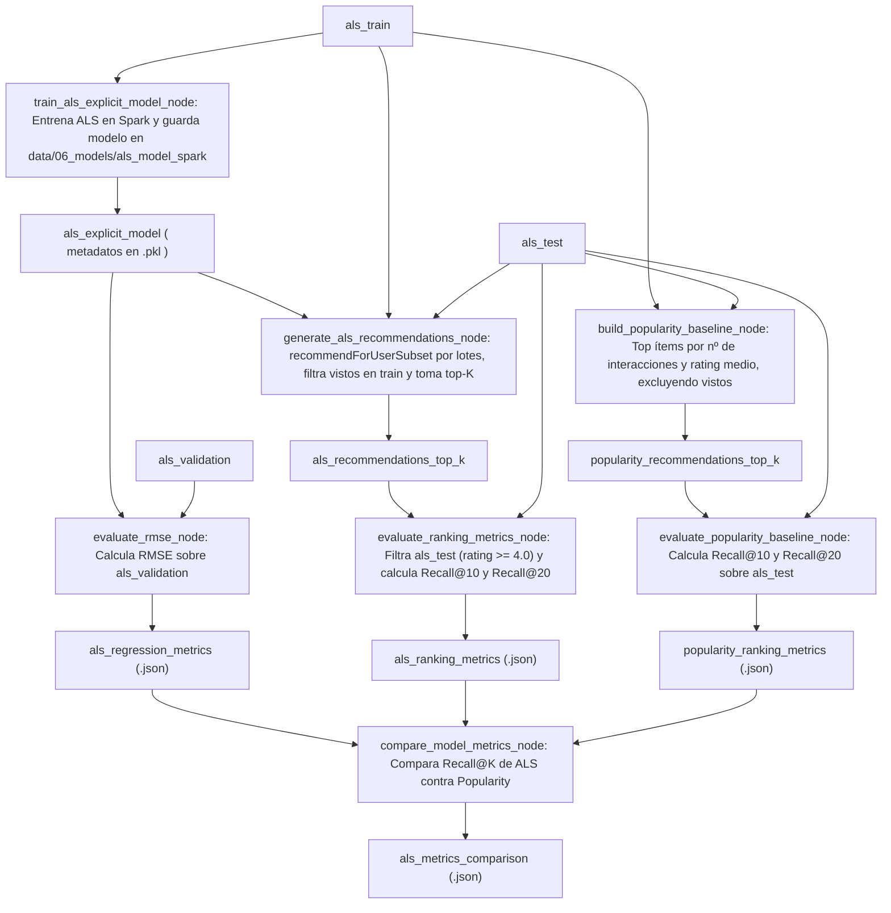
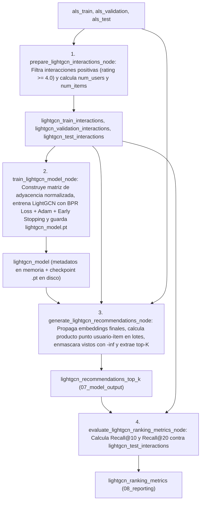
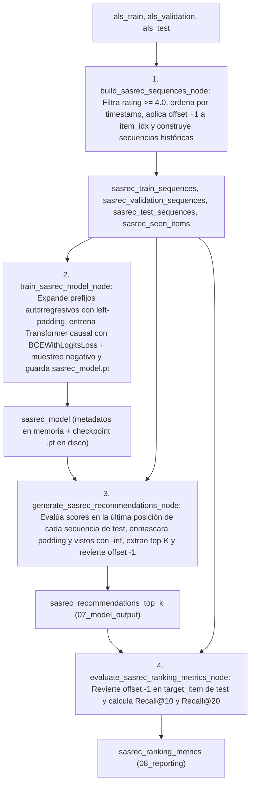
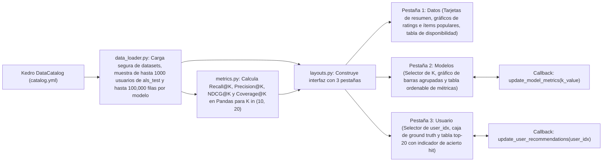

Esto es un resumen de lo que actualmente está implementado.

# Contexto del Repositorio `amazon-recsys`

`amazon-recsys` es un proyecto construido sobre **Kedro**, **PySpark**, **PyTorch** y **Dash** para procesar reseñas de la categoría *Video Games* de Amazon (dataset *Amazon Reviews 2023*), entrenar y evaluar cuatro sistemas de recomendación (**Popularity Baseline**, **ALS**, **LightGCN** y **SASRec**) y visualizar los resultados en un dashboard interactivo.

---

## 1. Estructura del Repositorio

```text
amazon-recsys/
├── conf/
│   ├── base/
│   │   ├── catalog.yml                        # Definición de los 22 datasets persistidos en disco
│   │   ├── parameters.yml                     # Hiperparámetros de ALS, LightGCN y SASRec
│   │   └── parameters_data_processing.yml     # Parámetros de filtrado y partición temporal
│   ├── local/                                 # Directorio para configuración local
│   ├── logging.yml                            # Configuración de logs (consola, Rich y archivo info.log)
│   └── README.md
├── data/
│   ├── 01_raw/                                # Datos crudos descargados (video_games.parquet)
│   ├── 02_intermediate/                       # Datos con columnas seleccionadas y limpias
│   ├── 03_primary/                            # Datos deduplicados y filtrados por actividad mínima
│   ├── 04_feature/                            # Datos indexados y tablas de mapeo user_idx / item_idx
│   ├── 05_model_input/                        # Particiones temporales: als_train, als_validation, als_test
│   ├── 06_models/                             # Modelos entrenados (Spark ALS, checkpoints .pt de PyTorch, .pkl)
│   ├── 07_model_output/                       # Tablas Parquet de recomendaciones top-K por modelo
│   └── 08_reporting/                          # Archivos JSON con métricas de evaluación y comparación
├── docs/
│   └── source/                                # Configuración de documentación Sphinx (conf.py, index.rst)
├── notebooks/
│   ├── 01_data_exploration.ipynb              # Exploración de datos crudos con PySpark y Seaborn
│   └── 02_model_evaluation.ipynb              # Evaluación comparativa de los modelos entrenados
├── scripts/
│   ├── download_data.py                       # Descarga del dataset desde Hugging Face a Parquet
│   └── run_dashboard.py                       # Punto de entrada para lanzar el servidor Dash
├── src/amazon_recsys/
│   ├── __init__.py                            # Define __version__ = "0.1"
│   ├── __main__.py                            # Punto de entrada CLI del paquete Kedro
│   ├── hooks.py                               # SparkHook para inicializar SparkSession
│   ├── pipeline_registry.py                   # Registro de los pipelines de Kedro
│   ├── recommender_metrics.py                 # Función compartida compute_recall_at_k en PySpark
│   ├── settings.py                            # Configuración de hooks y OmegaConfigLoader
│   ├── dashboard/                             # Aplicación web interactiva en Dash / Plotly
│   │   ├── __init__.py
│   │   ├── app.py                             # Factoría create_app() y carga de sesión Kedro
│   │   ├── callbacks.py                       # Callbacks reactivos de las pestañas Modelos y Usuario
│   │   ├── data_loader.py                     # Carga de datos desde el catálogo, muestreo y formateo
│   │   ├── layouts.py                         # Diseño visual y estructura de las 3 pestañas
│   │   └── metrics.py                         # Cálculo en Pandas de Recall@K, Precision@K, NDCG@K, Cobertura y Jaccard
│   └── pipelines/
│       ├── data_processing/                   # Limpieza, filtrado, indexación y split temporal
│       │   ├── nodes.py
│       │   └── pipeline.py
│       ├── recommender_als/                   # Modelo ALS en PySpark MLlib y baseline de popularidad
│       │   ├── nodes.py
│       │   └── pipeline.py
│       ├── recommender_lightgcn/              # Red neuronal de grafos LightGCN en PyTorch
│       │   ├── model.py
│       │   ├── nodes.py
│       │   └── pipeline.py
│       └── recommender_sasrec/                # Modelo secuencial basado en Transformer SASRec en PyTorch
│           ├── model.py
│           ├── nodes.py
│           └── pipeline.py
├── tests/                                     # Tests unitarios y de integración con pytest
│   ├── test_run.py
│   ├── dashboard/
│   │   ├── test_data_loader.py
│   │   └── test_metrics.py
│   └── pipelines/
│       ├── data_processing/test_pipeline.py
│       ├── data_science/test_pipeline.py
│       ├── recommender_als/test_pipeline.py
│       ├── recommender_lightgcn/test_pipeline.py
│       └── recommender_sasrec/test_pipeline.py
├── pyproject.toml                             # Metadatos del paquete, dependencias y configuración de herramientas
├── requirements.txt                           # Lista de dependencias base
└── uv.lock                                    # Lockfile de dependencias
```

---

## 2. Flujo General del Proyecto

El proyecto opera en cuatro etapas secuenciales:
1. **Ingesta de datos crudos** mediante `scripts/download_data.py`.
2. **Procesamiento de datos** mediante el pipeline `data_processing` de Kedro.
3. **Entrenamiento, inferencia y evaluación** mediante los pipelines `recommender_als`, `recommender_lightgcn` y `recommender_sasrec`.
4. **Visualización e inspección** mediante el dashboard (`scripts/run_dashboard.py`) o los notebooks.



---

## 3. Configuración, Puntos de Entrada y Pipelines Registrados

### 3.1 Inicialización de Kedro y Spark (`settings.py`, `hooks.py`, `__main__.py`)
- **`src/amazon_recsys/__main__.py`**: Define la función `main()`, que configura el proyecto Kedro (`configure_project("amazon_recsys")`) y ejecuta el comando de ejecución de Kedro. Está expuesta como script de consola bajo el nombre `amazon-recsys`.
- **`src/amazon_recsys/settings.py`**:
  - Registra `HOOKS = (SparkHook(),)`.
  - Configura `OmegaConfigLoader` con entorno base `"base"`, entorno por defecto `"local"` y patrón de configuración `"spark": ["spark*", "spark*/**"]`.
- **`src/amazon_recsys/hooks.py`**:
  - Define `SparkHook`. En el evento `after_context_created`, busca la clave `"spark"` en el `config_loader`. Si existe y tiene valores, construye o recupera una `SparkSession` aplicando cada par clave-valor y fija el nivel de log en `"WARN"`.

### 3.2 Registro de Pipelines (`src/amazon_recsys/pipeline_registry.py`)
La función `register_pipelines()` expone 6 nombres de ejecución:
- `__default__`: `data_processing + recommender_als`
- `data_processing`: Solo el pipeline de preparación de datos.
- `recommender_als`: Solo el pipeline ALS y baseline de popularidad.
- `recommender_lightgcn`: Solo el pipeline LightGCN.
- `recommender_sasrec`: Solo el pipeline SASRec.
- `all_recommenders`: `data_processing + recommender_als + recommender_lightgcn + recommender_sasrec`

### 3.3 Scripts Auxiliares (`scripts/`)
- **`scripts/download_data.py`**:
  1. Descarga el archivo `hf://datasets/McAuley-Lab/Amazon-Reviews-2023/raw/review_categories/Video_Games.jsonl` (split `"train"`) usando `datasets.load_dataset("json", ...)`.
  2. Crea el directorio `data/01_raw` si no existe.
  3. Guarda el contenido en formato Parquet en `data/01_raw/video_games.parquet`.
- **`scripts/run_dashboard.py`**:
  1. Importa `create_app` desde `amazon_recsys.dashboard.app`.
  2. Crea la instancia de la aplicación Dash y la ejecuta en `host="127.0.0.1"`, `port=8050`, `debug=False`.

---

## 4. Catálogo de Datos (`conf/base/catalog.yml`)

El catálogo registra 22 datasets distribuidos en las capas de datos del proyecto. Los datasets no listados en `catalog.yml` (como las secuencias intermedias de SASRec o las interacciones filtradas de LightGCN) se manejan en memoria (`MemoryDataset`) durante la ejecución del pipeline correspondiente.

| Nombre en Catálogo | Tipo de Dataset | Ruta en Disco | Capa |
|---|---|---|---|
| `raw_video_games_reviews` | `spark.SparkDataset` (parquet) | `data/01_raw/video_games.parquet` | `01_raw` |
| `recsys_interactions_selected` | `spark.SparkDataset` (parquet) | `data/02_intermediate/recsys_interactions_selected.parquet` | `02_intermediate` |
| `recsys_interactions_clean` | `spark.SparkDataset` (parquet) | `data/02_intermediate/recsys_interactions_clean.parquet` | `02_intermediate` |
| `recsys_interactions_deduplicated` | `spark.SparkDataset` (parquet) | `data/03_primary/recsys_interactions_deduplicated.parquet` | `03_primary` |
| `recsys_interactions_filtered` | `spark.SparkDataset` (parquet) | `data/03_primary/recsys_interactions_filtered.parquet` | `03_primary` |
| `recsys_interactions_indexed` | `spark.SparkDataset` (parquet) | `data/04_feature/recsys_interactions_indexed.parquet` | `04_feature` |
| `user_id_mapping` | `spark.SparkDataset` (parquet) | `data/04_feature/user_id_mapping.parquet` | `04_feature` |
| `item_id_mapping` | `spark.SparkDataset` (parquet) | `data/04_feature/item_id_mapping.parquet` | `04_feature` |
| `als_train` | `spark.SparkDataset` (parquet) | `data/05_model_input/als_train.parquet` | `05_model_input` |
| `als_validation` | `spark.SparkDataset` (parquet) | `data/05_model_input/als_validation.parquet` | `05_model_input` |
| `als_test` | `spark.SparkDataset` (parquet) | `data/05_model_input/als_test.parquet` | `05_model_input` |
| `als_explicit_model` | `pickle.PickleDataset` | `data/06_models/als_explicit_model.pkl` | `06_models` |
| `als_recommendations_top_k` | `spark.SparkDataset` (parquet) | `data/07_model_output/als_recommendations_top_k.parquet` | `07_model_output` |
| `popularity_recommendations_top_k` | `spark.SparkDataset` (parquet) | `data/07_model_output/popularity_recommendations_top_k.parquet` | `07_model_output` |
| `lightgcn_recommendations_top_k` | `spark.SparkDataset` (parquet) | `data/07_model_output/lightgcn_recommendations_top_k.parquet` | `07_model_output` |
| `sasrec_recommendations_top_k` | `spark.SparkDataset` (parquet) | `data/07_model_output/sasrec_recommendations_top_k.parquet` | `07_model_output` |
| `als_regression_metrics` | `json.JSONDataset` | `data/08_reporting/als_regression_metrics.json` | `08_reporting` |
| `als_ranking_metrics` | `json.JSONDataset` | `data/08_reporting/als_ranking_metrics.json` | `08_reporting` |
| `popularity_ranking_metrics` | `json.JSONDataset` | `data/08_reporting/popularity_ranking_metrics.json` | `08_reporting` |
| `als_metrics_comparison` | `json.JSONDataset` | `data/08_reporting/als_metrics_comparison.json` | `08_reporting` |
| `lightgcn_ranking_metrics` | `json.JSONDataset` | `data/08_reporting/lightgcn_ranking_metrics.json` | `08_reporting` |
| `sasrec_ranking_metrics` | `json.JSONDataset` | `data/08_reporting/sasrec_ranking_metrics.json` | `08_reporting` |

Todos los `spark.SparkDataset` tienen configurado `file_format: parquet` y `save_args: {mode: overwrite}`.

---

## 5. Pipeline `data_processing`

Definido en `src/amazon_recsys/pipelines/data_processing/nodes.py` y `pipeline.py`, y parametrizado mediante `conf/base/parameters_data_processing.yml`.

### 5.1 Flujo del Pipeline `data_processing`



### 5.2 Detalle de los Nodos de `data_processing`
1. **`select_recommender_columns(df)`**:
   - Selecciona `user_id`, `parent_asin` (renombrado a `item_id`), `rating` (convertido a `float`), `timestamp`, `verified_purchase` y `helpful_vote`.
2. **`clean_recommender_interactions(df)`**:
   - Elimina filas con valores nulos en `user_id`, `item_id` o `rating`.
   - Conserva únicamente filas donde `1 <= rating <= 5`.
   - Reemplaza valores negativos de `helpful_vote` por `0`.
3. **`deduplicate_user_item_interactions(df)`**:
   - Crea una ventana particionada por `("user_id", "item_id")` ordenada por `timestamp` descendente.
   - Calcula `row_number()` y conserva solo la fila `_rn == 1` (la interacción más reciente de ese usuario con ese producto).
4. **`filter_min_activity(df, min_user_interactions, min_item_interactions)`**:
   - Parámetros en `parameters_data_processing.yml`: `min_user_interactions: 3`, `min_item_interactions: 3`.
   - Primero agrupa por `user_id`, filtra los usuarios con al menos `min_user_interactions` interacciones y hace un `inner join` con el DataFrame.
   - Después, sobre el resultado ya filtrado por usuarios, agrupa por `item_id`, filtra los ítems con al menos `min_item_interactions` interacciones y hace un `inner join`.
5. **`index_user_item_ids(df)`**:
   - Ajusta dos modelos `StringIndexer` de PySpark ML (`handleInvalid="skip"`): uno para transformar `user_id` en `user_idx` y otro para transformar `item_id` en `item_idx` (ambos casteados a `int`). `StringIndexer` asigna índices `0, 1, 2, ...` ordenados por frecuencia descendente.
   - Devuelve tres DataFrames:
     - `indexed_df`: Columnas `["user_idx", "item_idx", "rating", "timestamp", "user_id", "item_id"]`.
     - `user_mapping`: Tabla de correspondencia `["user_id", "user_idx"]` extraída de `user_model.labels`.
     - `item_mapping`: Tabla de correspondencia `["item_id", "item_idx"]` extraída de `item_model.labels`.
6. **`temporal_train_validation_test_split(df, split_params)`**:
   - Parámetros en `parameters_data_processing.yml`: `use_validation: true`, `timestamp_col: "timestamp"`.
   - Particiona por `user_id` y ordena las interacciones de cada usuario por `timestamp` descendente asignando `_rank = row_number()`.
   - **`test` (`als_test`)**: Interacción más reciente de cada usuario (`_rank == 1`).
   - Si `use_validation` es `True`:
     - **`validation` (`als_validation`)**: Segunda interacción más reciente de cada usuario (`_rank == 2`).
     - **`train` (`als_train`)**: Resto de interacciones históricas del usuario (`_rank >= 3`).
   - Si `use_validation` es `False`:
     - **`validation`**: DataFrame vacío con el mismo esquema.
     - **`train`**: Todas las interacciones con `_rank >= 2`.

---

## 6. Métrica de Ranking Compartida (`src/amazon_recsys/recommender_metrics.py`)

El módulo `recommender_metrics.py` implementa la función PySpark `compute_recall_at_k(recommendations, ground_truth, k) -> float`, utilizada por los pipelines de LightGCN y SASRec (y replicada en `recommender_als/nodes.py` como `_compute_recall_at_k`):
1. Obtiene los pares únicos `(user_idx, item_idx)` del `ground_truth` y cuenta cuántos ítems relevantes tiene cada usuario (`total_relevant`).
2. Filtra el DataFrame `recommendations` conservando solo filas con `rank <= k`.
3. Realiza un `inner join` entre el top-K recomendado y los ítems relevantes por `["user_idx", "item_idx"]` y cuenta los aciertos por usuario (`num_hits`).
4. Hace un `left join` desde `total_relevant` hacia `num_hits`, rellenando con `0` los usuarios sin aciertos.
5. Calcula para cada usuario $\text{recall}_u = \frac{\text{num\_hits}_u}{\text{total\_relevant}_u}$ y devuelve el promedio (`F.avg("recall")`) sobre todos los usuarios con ground truth.

---

## 7. Pipeline `recommender_als` (ALS y Baseline de Popularidad)

Definido en `src/amazon_recsys/pipelines/recommender_als/nodes.py` y `pipeline.py`. Entrena un modelo de factorización matricial mediante Mínimos Cuadrados Alternantes (`pyspark.ml.recommendation.ALS`) y construye en paralelo un recomendador baseline basado en popularidad.

### 7.1 Flujo del Pipeline `recommender_als`



### 7.2 Detalle de los Nodos y Parámetros de `recommender_als`
- **Parámetros (`conf/base/parameters.yml` -> `recommender_als`)**:
  - `als`: `user_col: "user_idx"`, `item_col: "item_idx"`, `rating_col: "rating"`, `rank: 50`, `maxIter: 10`, `regParam: 0.1`, `nonnegative: false`, `implicitPrefs: true`, `coldStartStrategy: "drop"`, `seed: 42`.
  - `recommendations`: `k: 20`, `num_candidates: 200`, `user_batch_size: 500`.
  - `evaluation`: `k_values: [10, 20]`, `positive_threshold: 4.0`.
- **Nodos (`src/amazon_recsys/pipelines/recommender_als/nodes.py`)**:
  1. **`train_als_explicit_model(train, als_params)`**:
     - Ajusta `ALS` de PySpark sobre `als_train`.
     - Guarda el modelo Spark nativo en `model_path` (`"data/06_models/als_model_spark"`) usando `model.write().overwrite().save(model_path)`.
     - Devuelve un diccionario con los hiperparámetros y `model_path`, que Kedro serializa en `data/06_models/als_explicit_model.pkl`.
  2. **`generate_als_recommendations(model_info, als_train, als_test, recommender_params)`**:
     - Carga el `ALSModel` desde `model_info["model_path"]`.
     - Obtiene los `user_idx` únicos de `als_test` y construye en el driver un diccionario `seen_by_user` con todos los pares `(user_idx, item_idx)` presentes en `als_train`.
     - Procesa los usuarios de test en lotes de tamaño `user_batch_size` (`500`): llama a `model.recommendForUserSubset(batch_df, num_candidates)` (`200` candidatos), ordena por `score` descendente, descarta los ítems ya vistos en `als_train`, selecciona los primeros `k` (`20`) y les asigna `rank` de `1` a `k`.
     - Devuelve un DataFrame Spark con columnas `["user_idx", "item_idx", "score", "rank"]`.
  3. **`evaluate_rmse(model_info, als_validation)`**:
     - Carga el `ALSModel`, ejecuta `model.transform(als_validation)` y evalúa el error cuadrático medio (`rmse`) con `RegressionEvaluator`. Devuelve `{"rmse": round(rmse, 6)}`.
  4. **`evaluate_ranking_metrics(als_recommendations_top_k, als_test, evaluation_params)`**:
     - Filtra `als_test` conservando únicamente las interacciones positivas (`rating >= 4.0`).
     - Calcula `recall@10` y `recall@20` mediante `_compute_recall_at_k`.
  5. **`build_popularity_baseline(als_train, als_test, recommender_params)`**:
     - Agrupa `als_train` por `item_idx` calculando el número total de interacciones (`score`) y el rating promedio (`avg_rating`).
     - Selecciona los `max(k * 10, 200)` ítems más populares ordenados por `score DESC, avg_rating DESC`.
     - Hace un `crossJoin` con los usuarios únicos de `als_test`, elimina los ítems ya consumidos por cada usuario en `als_train` mediante un `left_anti` join, y asigna el ranking de `1` a `k` por usuario.
  6. **`evaluate_popularity_baseline(popularity_recommendations_top_k, als_test, evaluation_params)`**:
     - Calcula `recall@10` y `recall@20` comparando las recomendaciones de popularidad contra `als_test`.
  7. **`compare_model_metrics(als_regression_metrics, als_ranking_metrics, popularity_ranking_metrics)`**:
     - Combina los tres diccionarios de métricas y añade el booleano `"als_beats_popularity"`, que es `True` si el Recall de ALS supera estrictamente al de Popularity en todos los valores de `k`.

---

## 8. Pipeline `recommender_lightgcn` (LightGCN)

Definido en `src/amazon_recsys/pipelines/recommender_lightgcn/model.py`, `nodes.py` y `pipeline.py`. Implementa **LightGCN** (Light Graph Convolutional Network) en PyTorch sobre el grafo bipartito usuario-ítem.

### 8.1 Arquitectura del Modelo (`recommender_lightgcn/model.py`)
- **`LightGCNConfig`**: Dataclass inmutable con `num_users`, `num_items`, `embedding_dim` (`64`) y `n_layers` (`3`).
- **`build_normalized_adj(interactions, num_users, num_items)`**:
  - Construye un grafo bipartito no dirigido de `total_nodes = num_users + num_items` nodos, donde los usuarios ocupan los índices `[0, num_users - 1]` y los ítems ocupan `[num_users, num_users + num_items - 1]`.
  - Por cada interacción `(u, i)` añade las aristas `(u, num_users + i)` y `(num_users + i, u)`.
  - Calcula el grado $D$ de cada nodo y construye la matriz de adyacencia simétricamente normalizada en formato disperso COO de PyTorch:
    $$\tilde{A} = D^{-1/2} A D^{-1/2}$$
- **Clase `LightGCN`**:
  - Contiene dos tablas de embeddings (`torch.nn.Embedding`) inicializadas con una distribución normal ($\sigma = 0.01$): `user_embedding` y `item_embedding`.
  - **`propagate(normalized_adj)`**:
    1. Concatena los embeddings iniciales $\mathbf{E}^{(0)} = [\mathbf{E}_{\text{user}}^{(0)} \| \mathbf{E}_{\text{item}}^{(0)}]$.
    2. Durante `n_layers` capas aplica paso de mensajes lineal sin funciones de activación ni matrices de pesos adicionales:
       $$\mathbf{E}^{(l+1)} = \tilde{A} \mathbf{E}^{(l)}$$
    3. Promedia las representaciones de todas las capas (desde $0$ hasta $L$):
       $$\mathbf{E}^{(\text{final})} = \frac{1}{L+1} \sum_{l=0}^{L} \mathbf{E}^{(l)}$$
    4. Separa y devuelve los tensores `user_final` y `item_final`.
- **Función de pérdida `bpr_loss(user_emb, pos_emb, neg_emb, reg_weight)`**:
  - Calcula las puntuaciones por producto interno para los ítems positivos y negativos ($\hat{y}_{ui} = \mathbf{e}_u \cdot \mathbf{e}_i^+$, $\hat{y}_{uj} = \mathbf{e}_u \cdot \mathbf{e}_j^-$).
  - Combina la pérdida Bayesian Personalized Ranking (BPR) con penalización $L_2$:
    $$\mathcal{L} = -\text{mean}\left(\log \sigma(\hat{y}_{ui} - \hat{y}_{uj})\right) + \lambda_{\text{reg}} \frac{\|\mathbf{e}_u\|_2^2 + \|\mathbf{e}_i^+\|_2^2 + \|\mathbf{e}_j^-\|_2^2}{2N}$$

### 8.2 Flujo del Pipeline `recommender_lightgcn`



### 8.3 Detalle de los Nodos y Parámetros de `recommender_lightgcn`
- **Parámetros (`conf/base/parameters.yml` -> `recommender_lightgcn`)**:
  - `data`: `positive_threshold: 4.0`.
  - `model`: `embedding_dim: 64`, `n_layers: 3`, `learning_rate: 0.001`, `reg_weight: 0.0001`, `batch_size: 2048`, `epochs: 200`, `patience: 15`, `min_delta: 0.0001`, `seed: 42`, `model_path: "data/06_models/lightgcn_model.pt"`.
  - `recommendations`: `k: 20`, `score_batch_size: 256`.
  - `evaluation`: `k_values: [10, 20]`.
- **Nodos (`src/amazon_recsys/pipelines/recommender_lightgcn/nodes.py`)**:
  1. **`prepare_lightgcn_interactions(train, validation, test, data_params)`**:
     - Filtra `train`, `validation` y `test` conservando únicamente filas con `rating >= 4.0` y eliminando duplicados `["user_idx", "item_idx"]`.
     - Calcula `num_users = max(user_idx) + 1` y `num_items = max(item_idx) + 1` considerando las tres particiones.
  2. **`train_lightgcn_model(lightgcn_train_interactions, lightgcn_validation_interactions, model_params)`**:
     - Selecciona dispositivo (`cuda` si está disponible, si no `cpu`).
     - Construye la matriz de adyacencia normalizada sobre los pares positivos de entrenamiento (`train_pairs`).
     - En cada época propaga los embeddings sobre el grafo, mezcla los pares positivos, muestrea uniformemente 1 ítem negativo no visto por cada interacción positiva (`_sample_negative`), calcula `bpr_loss` por lotes de `2048` y actualiza los embeddings con `Adam`.
     - Aplica parada temprana (*early stopping*) monitorizando la mejora de la pérdida media de entrenamiento con `patience = 15` y `min_delta = 0.0001`.
     - Guarda un checkpoint PyTorch en `data/06_models/lightgcn_model.pt` con `config`, `state_dict` y `train_pairs`.
  3. **`generate_lightgcn_recommendations(lightgcn_model, lightgcn_train_interactions, als_test, recommender_params)`**:
     - Recarga el modelo y reconstruye la matriz de adyacencia desde el checkpoint.
     - Ejecuta `model.propagate(normalized_adj)` sin gradientes (`torch.no_grad()`).
     - Para los usuarios de `als_test` (en bloques de `score_batch_size = 256`), calcula la matriz de puntuaciones `scores = user_final[batch] @ item_final.T`, asigna `-inf` a los ítems ya vistos en `lightgcn_train_interactions` y extrae el top `k` (`20`) con `torch.topk`.
  4. **`evaluate_lightgcn_ranking_metrics(lightgcn_recommendations_top_k, lightgcn_test_interactions, evaluation_params)`**:
     - Calcula `recall@10` y `recall@20` invocando `compute_recall_at_k` de `recommender_metrics.py`.

---

## 9. Pipeline `recommender_sasrec` (SASRec)

Definido en `src/amazon_recsys/pipelines/recommender_sasrec/model.py`, `nodes.py` y `pipeline.py`. Implementa **SASRec** (Self-Attentive Sequential Recommendation) mediante un codificador Transformer causal en PyTorch.

### 9.1 Arquitectura del Modelo (`recommender_sasrec/model.py`)
- **`SASRecConfig`**: Dataclass inmutable con `num_items`, `max_seq_len` (`50`), `hidden_size` (`64`), `inner_size` (`256`), `n_layers` (`2`), `n_heads` (`2`) y `dropout` (`0.2`).
- **Módulo Interno `_SASRecTorchModule` y Envoltura `SASRecModel`**:
  - Reserva el índice `0` para el token de *padding*. Todos los `item_idx` originales se desplazan sumando `item_id_offset = 1`.
  - Capas:
    - `item_embedding`: `nn.Embedding(num_items + 1, hidden_size, padding_idx=0)`.
    - `position_embedding`: `nn.Embedding(max_seq_len, hidden_size)`.
    - `encoder`: `nn.TransformerEncoder` compuesto por `n_layers` capas `nn.TransformerEncoderLayer` (`d_model=hidden_size`, `nhead=n_heads`, `dim_feedforward=inner_size`, `activation="gelu"`, `batch_first=True`).
    - `layer_norm` (`nn.LayerNorm`) y `dropout` (`nn.Dropout`).
  - **Paso hacia adelante (`forward`)**:
    1. Suma los embeddings de ítem y de posición, seguidos de `Dropout` y `LayerNorm`.
    2. Construye dos máscaras:
       - `padding_mask`: posiciones donde la secuencia vale `0`.
       - `causal_mask`: matriz triangular superior (`torch.triu(..., diagonal=1)`) que impide que una posición atienda a ítems futuros.
    3. Pasa la secuencia por el `TransformerEncoder` aplicando ambas máscaras y anula (`0.0`) las posiciones de padding.
  - **Puntuación de candidatos (`scores(sequences)`)**:
    - Como las secuencias se rellenan con ceros por la izquierda (`_pad_left`), el último elemento de la secuencia (`output[:, -1]`) representa el estado del usuario tras su interacción más reciente.
    - Calcula el producto interno entre `output[:, -1]` y todos los vectores de `item_embedding.weight`, devolviendo un tensor de tamaño `(batch_size, num_items + 1)`.

### 9.2 Flujo del Pipeline `recommender_sasrec`



### 9.3 Detalle de los Nodos y Parámetros de `recommender_sasrec`
- **Parámetros (`conf/base/parameters.yml` -> `recommender_sasrec`)**:
  - `data`: `max_seq_len: 50`, `min_sequence_length: 1`, `item_id_offset: 1`, `test_history_policy: "train_plus_validation"`, `positive_threshold: 4.0`.
  - `model`: `max_seq_len: 50`, `hidden_size: 64`, `inner_size: 256`, `n_layers: 2`, `n_heads: 2`, `dropout: 0.2`, `learning_rate: 0.001`, `batch_size: 256`, `epochs: 200`, `patience: 15`, `min_delta: 0.0001`, `seed: 42`, `model_path: "data/06_models/sasrec_model.pt"`.
  - `recommendations`: `k: 20`, `item_id_offset: 1`.
  - `evaluation`: `k_values: [10, 20]`, `item_id_offset: 1`.
- **Nodos (`src/amazon_recsys/pipelines/recommender_sasrec/nodes.py`)**:
  1. **`build_sasrec_sequences(als_train, als_validation, als_test, data_params)`**:
     - Filtra interacciones con `rating >= 4.0` en cada split, ordena por `user_idx` y `timestamp` ascendente y suma `item_id_offset` (`+1`) a cada `item_idx`.
     - Crea secuencias truncadas a los últimos `max_seq_len` (`50`) ítems:
       - `sasrec_train_sequences`: Secuencia de entrenamiento y último ítem como `target_item`.
       - `sasrec_validation_sequences`: Historial de entrenamiento como entrada y primer ítem de validación como `target_item`.
       - `sasrec_test_sequences`: Historial combinado de entrenamiento + validación (según `test_history_policy == "train_plus_validation"`) como entrada y primer ítem de test como `target_item`.
       - `sasrec_seen_items`: Todos los pares `(user_idx, item_idx)` vistos en el historial (con IDs originales sin offset).
  2. **`train_sasrec_model(sasrec_train_sequences, sasrec_validation_sequences, model_params)`**:
     - Genera ejemplos de entrenamiento autorregresivos (`_training_examples`): para cada secuencia de usuario de longitud $L \ge 2$, toma cada prefijo `sequence[:p]` (rellenado con ceros a la izquierda hasta `max_seq_len`) para predecir el siguiente ítem `sequence[p]`. Si una secuencia tiene longitud $1$, genera el par `(pad_left([item]), item)`.
     - En cada lote muestrea un ítem negativo no visto por el usuario (`_sample_negative`), calcula los logits del ítem positivo y del negativo mediante producto punto con el estado final `sequence_output(sequences)[:, -1]` y optimiza `BCEWithLogitsLoss` con `Adam`.
     - Aplica parada temprana con `patience = 15` y guarda el checkpoint en `data/06_models/sasrec_model.pt`.
  3. **`generate_sasrec_recommendations(sasrec_model, sasrec_test_sequences, sasrec_seen_items, recommender_params)`**:
     - Carga el modelo desde `sasrec_model.pt` en modo evaluación.
     - Para cada usuario en `sasrec_test_sequences`, rellena su secuencia por la izquierda hasta `max_seq_len`, calcula `model.scores(tensor)[0]`, asigna `-inf` al índice `0` (padding) y a todos los ítems vistos desplazados (`seen_item + item_id_offset`), obtiene el top `k` (`20`) con `torch.topk` y resta `item_id_offset` para devolver los `item_idx` originales.
  4. **`evaluate_sasrec_ranking_metrics(sasrec_recommendations_top_k, sasrec_test_sequences, evaluation_params)`**:
     - Resta `item_id_offset` a la columna `target_item` de `sasrec_test_sequences` para recuperar el `item_idx` real y calcula `recall@10` y `recall@20` con `compute_recall_at_k`.

---

## 10. Dashboard Interactivo (`src/amazon_recsys/dashboard/`)

El paquete `amazon_recsys.dashboard` construye una aplicación web en **Dash** y **Plotly** para inspeccionar el dataset, comparar las métricas de los cuatro modelos y explorar las recomendaciones individuales por usuario.

### 10.1 Flujo de Carga y Reactividad del Dashboard



### 10.2 Módulos del Dashboard
1. **`app.py` (`create_app`)**:
   - Inicia una `KedroSession`, obtiene el `catalog` y carga:
     - Disponibilidad de los 4 modelos (`Popularity`, `ALS`, `LightGCN`, `SASRec`).
     - Resumen estadístico del dataset (`load_dataset_overview`).
     - Muestra de hasta `max_test_users = 1000` usuarios de `als_test` con interacciones positivas (`rating >= 4.0`) y sus recomendaciones asociadas.
     - Tabla consolidada de métricas (`build_metric_table`) para $K \in [10, 20]$.
   - Configura la plantilla HTML/CSS (`INDEX_STRING`), monta el layout y registra los callbacks.
2. **`data_loader.py`**:
   - Mapea los 4 modelos a sus datasets en `MODEL_RECOMMENDATION_DATASETS`.
   - `_safe_load`: Intenta cargar cualquier dataset del catálogo capturando excepciones si aún no ha sido generado.
   - `load_dataset_overview`: Carga `als_test` (o `als_train` si `als_test` no existe) y calcula número de usuarios, número de ítems, total de interacciones, distribución de ratings, top 15 ítems más frecuentes y *sparsity* ($1 - \frac{\text{interacciones}}{\text{usuarios} \times \text{ítems}}$).
   - `load_ground_truth`: Filtra `als_test` por `rating >= positive_threshold` y toma una muestra aleatoria reproducible (`seed=42`) de hasta `1000` usuarios.
   - `top_recommendations_with_hits`: Para un `user_idx` dado, cruza el top-K de cada modelo disponible con los ítems relevantes del usuario en test y añade la columna booleana `hit`.
3. **`metrics.py`**:
   - Implementa en Pandas las métricas de evaluación sobre la muestra de usuarios:
     - `ranking_metrics_at_k`: Calcula **Recall@K**, **Precision@K** y **NDCG@K** ($\text{DCG}@K / \text{IDCG}@K$ con descuento logarítmico $\frac{1}{\log_2(\text{rank}+1)}$) promediados por usuario.
     - `catalog_coverage_at_k`: Proporción de ítems únicos recomendados en el top-K respecto al total de ítems del catálogo (`catalog_size`).
     - `average_jaccard_at_k`: Similitud de Jaccard promedio por usuario ($\frac{|A \cap B|}{|A \cup B|}$) entre las listas top-K de dos modelos.
     - `build_metric_table`: Genera el DataFrame con columnas `["model", "k", "recall", "precision", "ndcg", "coverage"]`.
4. **`layouts.py` y `callbacks.py`**:
   - **Pestaña `Datos`**: Muestra 4 tarjetas (`Usuarios`, `Items`, `Interacciones`, `Sparsity`), dos gráficos de barras en Plotly Express (distribución de ratings y top 15 ítems) y una tabla con el estado de disponibilidad de cada modelo.
   - **Pestaña `Modelos`**: Contiene el desplegable `k-selector`. Al cambiar el valor de $K$, el callback `update_model_metrics` actualiza el gráfico de barras agrupadas (`metric-bars`) y la tabla de métricas (`metrics-table`) ordenada de mayor a menor Recall.
   - **Pestaña `Usuario`**: Contiene el desplegable `user-selector`. Al elegir un usuario, el callback `update_user_recommendations` muestra los ítems reales consumidos por ese usuario en test (`ground-truth-box`) y actualiza la tabla `user-recommendations-table` con las 20 recomendaciones principales de cada modelo y si acertaron (`hit`).

---

## 11. Notebooks (`notebooks/`)

1. **`notebooks/01_data_exploration.ipynb`**:
   - Carga `data/01_raw/video_games.parquet` en PySpark.
   - Analiza dimensiones del dataset, esquema, valores nulos o vacíos por columna, estadísticas y distribución de `rating`, rango temporal de las reseñas por año, pares `(user_id, parent_asin)` duplicados, cardinalidad de usuarios e ítems, *sparsity* de la matriz, cuantiles de actividad por usuario y producto, proporción de compras verificadas (`verified_purchase`) y votos útiles (`helpful_vote`).
   - Compara la tasa de retención de filas, usuarios e ítems bajo 6 escenarios progresivos de limpieza y filtrado.
2. **`notebooks/02_model_evaluation.ipynb`**:
   - Carga desde el catálogo de Kedro el conjunto `als_test` y las tablas de recomendaciones disponibles (`Popularity`, `ALS`, `LightGCN`, `SASRec`).
   - Toma una muestra de hasta 1000 usuarios de test con `rating >= 4.0`.
   - Calcula y grafica **Recall@K**, **Precision@K**, **NDCG@K** y **Cobertura de catálogo** para $K \in [10, 20]$.
   - Calcula la similitud de Jaccard entre cada par de modelos para medir el solapamiento entre sus recomendaciones y muestra ejemplos de recomendaciones para 5 usuarios.

---

## 12. Suite de Tests (`tests/`)

Los tests están implementados con `pytest` y una sesión local de PySpark (`local[2]`):
- **`tests/test_run.py`**: Verifica el arranque del proyecto Kedro y la creación de `KedroSession`.
- **`tests/dashboard/test_data_loader.py`**: Verifica la detección de modelos disponibles/faltantes en el catálogo (`model_availability`), la carga selectiva de tablas de recomendaciones (`available_recommendation_tables`) y el marcado de aciertos (`hit`) en `top_recommendations_with_hits` usando un `DummyCatalog`.
- **`tests/dashboard/test_metrics.py`**: Verifica el cálculo exacto de `ranking_metrics_at_k` (Recall, Precision, NDCG), `catalog_coverage_at_k` y `average_jaccard_at_k`.
- **`tests/pipelines/data_processing/test_pipeline.py`**: Prueba unitariamente `select_recommender_columns`, `clean_recommender_interactions`, `deduplicate_user_item_interactions`, `filter_min_activity` y `temporal_train_validation_test_split`.
- **`tests/pipelines/recommender_als/test_pipeline.py`**: Prueba `_compute_recall_at_k` (recall perfecto, parcial, cero y corte por $K$), `evaluate_popularity_baseline` y `compare_model_metrics`.
- **`tests/pipelines/recommender_lightgcn/test_pipeline.py`**: Prueba el filtrado de interacciones positivas en `prepare_lightgcn_interactions` y la evaluación en `evaluate_lightgcn_ranking_metrics`.
- **`tests/pipelines/recommender_sasrec/test_pipeline.py`**: Prueba la construcción de secuencias cronológicas, el desplazamiento de IDs (`item_id_offset`) y la recopilación de ítems vistos en `build_sasrec_sequences`, así como la evaluación en `evaluate_sasrec_ranking_metrics`.
- **`tests/pipelines/data_science/test_pipeline.py`**: Archivo con docstring de marcador de posición sin funciones de test.
